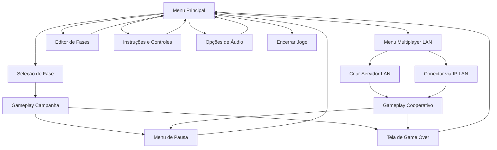
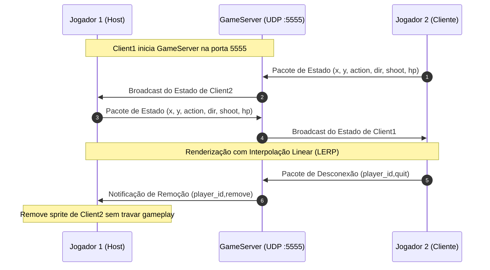

# GDD TAC III — PyShooter (Atualizado - Trabalho 2)

**Fundação Universidade Federal da Grande Dourados (UFGD)**  
**Faculdade de Engenharia (FAEN) — Engenharia de Computação**  
**Disciplina:** Tópicos Avançados em Computação III (TAC III)  
**Professor:** Vanderson Hafemann Fragal  

**Desenvolvedores:**  
- **Guilherme Silva Sampaio:** Arquitetura de software, multiplayer LAN (UDP/threads), integração do editor de fases, implementação de padrões de projeto, diagramas UML, refatoração segura e documentação do GDD.  
- **Pedro Henrique Gonçalves Mota:** Concepção da base do jogo, obtenção e adaptação de assets gráficos/sonoros, mecânicas de gameplay, chefes, fases e testes.  

---

## 1. Game Design Document (GDD)

### 1.1 Conceito Principal
**PyShooter** é um jogo de ação 2D *side-scrolling* no estilo *Run and Gun*, desenvolvido em **Python** e **Pygame**. O jogador assume o controle de um soldado em missão de combate através de biomas naturais hostis (florestas de pinheiros, cordilheiras nevadas e pântanos densos). O personagem avança horizontalmente enfrentando soldados de infantaria, snipers, atiradores robóticos, esqueletos arqueiros e chefes colossais (Demon Boss e Dragon Boss), coletando suprimentos (munição, kits médicos e granadas) e superando armadilhas de terreno. O objetivo de cada fase é sobreviver aos combates e alcançar o portal de extração para avançar na campanha.

No **Trabalho 2**, o jogo expandiu suas fronteiras com a inclusão de:
1. **Navegação Completa por Menus**: Menu Principal, Seleção de Fases, Menu Multiplayer LAN, Editor de Fases, Instruções, Configurações de Áudio com sliders e Telas de Pausa/Fim de Jogo.
2. **Editor de Fases Integrado**: Ferramenta modular que permite criar, inspecionar, salvar e carregar mapas personalizados diretamente na matriz de arquivos CSV (`levels/`).
3. **Multiplayer em LAN (Cliente e Servidor)**: Partidas cooperativas locais em tempo real via sockets UDP não-bloqueantes com threads em background, controle de *heartbeat/timeout*, sincronização de combate e interpolação linear (LERP) para eliminar saltos visuais.
4. **Formalização de Padrões de Projeto (GoF e Arquiteturais)**: Aplicação explícita dos padrões Singleton, State, Factory Method, Facade, Observer e Remote Proxy.

---

### 1.2 Estilo e Gênero

| Aspecto | Classificação |
| :--- | :--- |
| **Gênero primário** | Run and Gun / 2D Platformer Shooter |
| **Subgênero** | Side-scrolling Action / Co-op Multiplayer |
| **Perspectiva** | Vista lateral 2D (Side-view) |
| **Referências clássicas** | *Metal Slug*, *Contra*, *Mega Man*, *Ghosts 'n Goblins* |

O foco do jogo é a precisão de movimento, agilidade de esquiva e combate estratégico com armas de tiro reto e arremessos parabólicos de granadas contra agrupamentos de inimigos.

---

### 1.3 Plataforma Alvo

| Requisito | Especificação |
| :--- | :--- |
| **Sistema Operacional** | Windows 10/11, Linux ou macOS |
| **Linguagem / Versão** | Python 3.10+ (compatível com 3.12+) |
| **Dependências Principais** | `pygame` (2.5+), `Pillow` |
| **Resolução de Tela** | 1200 × 640 pixels (Modo Editor: 1200 × 740 pixels) |
| **Periféricos** | Teclado (movimento e combate), Mouse (menus, sliders e editor) |
| **Rede** | Conexão Ethernet ou Wi-Fi em LAN (UDP porta 5555) |

---

### 1.4 Mecânicas e Controles

#### 1.4.1 Mapa de Controles

##### Controles de Gameplay (In-Game)
| Tecla | Ação |
| :--- | :--- |
| **A** ou **←** | Mover para a esquerda |
| **D** ou **→** | Mover para a direita |
| **W** ou **↑** | Pular |
| **Espaço** | Disparo de arma primária (segurar para tiro contínuo) |
| **Q** ou **G** | Lançar granada (arco parabólico com dano em área) |
| **ESC** | Pausar partida / Retornar ao menu |

##### Controles do Editor de Fases (Level Editor)
| Controle | Ação |
| :--- | :--- |
| **Botão Esquerdo do Mouse** | Pintar o tile selecionado na grade |
| **Botão Direito do Mouse** | Apagar tile da grade (define como vazio `-1`) |
| **← / →** | Rolar a visão horizontal do mapa no editor |
| **Shift Esquerdo / Direito** | Multiplicador de velocidade de rolagem (5x mais rápido) |
| **↑ / ↓** | Alternar número da fase ativa (Fase 1, 2, 3...) |
| **Botão "Salvar"** | Persiste a matriz editada em `levels/level{N}_data.csv` |
| **Botão "Carregar"** | Recarrega os dados do arquivo CSV correspondente |
| **Botão "<- Menu" / ESC** | Restaura a resolução padrão e retorna ao Menu Principal |

##### Controles de Interface e Menus
- **Mouse (Clique Esquerdo):** Interage com botões de navegação, caixas de diálogo, caixas de texto de IP e seleção de fases.
- **Sliders de Áudio:** Arraste interativo para ajuste contínuo de volume da música de fundo e efeitos sonoros (SFX).

---

### 1.5 Arquitetura de Menus e Telas

A interface do PyShooter é estruturada sob o padrão **State**, onde o loop central do jogo delega a captura de eventos, atualização de estados e renderização visual para telas especializadas localizadas em `ui/screens/`.

#### Descrição das Telas:
1. **Menu Principal (`MainMenuScreen`):** Tela inicial elegante com o título do jogo e acesso direto a todas as áreas (Novo Jogo, Multiplayer, Editor de Fases, Instruções, Configurações e Sair).
2. **Seleção de Fase (`LevelSelectScreen`):** Exibe os gamepads interativos para escolha de fases da campanha (Fases 1 a 4).
3. **Menu Multiplayer LAN (`MultiplayerMenuScreen`):** Interface dedicada que permite:
   - **Criar Servidor (Host):** Inicializa o socket UDP local e conecta automaticamente o jogador hospedeiro como Jogador 1.
   - **Conectar via IP (Join LAN):** Campo de entrada de texto interativo com cursor piscante para informar o endereço IP do Host (padrão `127.0.0.1`, porta `5555`) e botão de conexão como Jogador 2.
   - Exibição em tempo real de mensagens de status da rede.
4. **Editor de Fases (`LevelEditorScreen`):** Ambiente de edição de fases completo com grade, paleta de tiles, atalhos de teclado e botões de I/O em disco.
5. **Configurações (`OptionsScreen`):** Ajuste de volume de música e efeitos sonoros através de barras com botões deslizantes (*knobs*) proporcionais.
6. **Pausa (`PauseOverlay`):** Overlay escurecido sobre a partida em andamento permitindo continuar ou sair para o menu.
7. **Game Over (`GameOverScreen`):** Exibida ao esgotar os pontos de vida do soldado, permitindo reiniciar a fase imediatamente ou voltar ao menu.

---

### 1.6 O Editor de Fases (Level Editor)

O editor de fases foi refatorado de um script procedural legado (`level-editor.py`) para uma classe modular de alta coesão (`LevelEditorScreen` em `ui/screens/level_editor.py`), perfeitamente integrada ao ciclo de vida do jogo.

#### Especificações Técnicas do Editor:
- **Resolução de Tela Estendida:** Ao entrar no editor, a janela é redimensionada dinamicamente para `1200 × 740` pixels (oferecendo 900 pixels de largura de visão de mapa, 300 pixels de barra lateral direita para a paleta de blocos e 100 pixels de margem inferior para a barra de ferramentas). Ao retornar ao menu, a resolução nativa de `1200 × 640` é restabelecida sem falhas.
- **Estrutura Matricial:** O mapa é composto por uma matriz bidimensional de dimensões fixas:
  $$\text{Linhas} = 16, \quad \text{Colunas} = 200, \quad \text{Tamanho do Bloco} = 40 \times 40\text{ px}$$
- **Paleta de 88 Tiles Mapeados:**
  - `0 a 8, 24 a 35, 47 a 48, 50, 58 a 61, 65 a 66, 73 a 77, 83 a 84`: Terrenos e plataformas sólidas (terra, grama, pedra e neve).
  - `85`: Rampa com colisão diagonal/inclinada.
  - `9 a 10, 37 a 39, 42 a 46, 51 a 57, 62 a 64, 67 a 68`: Água profunda (perigo ambiental letal).
  - `11 a 14, 36, 40 a 41, 49, 71 a 72, 78 a 82`: Decorações visuais sem colisão física (árvores gigantes, pinheiros, placas, grama decorativa).
  - `15`: Ponto de geração (*Spawn*) do Jogador.
  - `16`: Spawn de Soldado patrulheiro básico.
  - `69`: Spawn de Inimigo Robô atirador.
  - `70`: Spawn de Inimigo Esqueleto arqueiro.
  - `86`: Spawn do Demônio Chefe terrestre (*Demon Boss*).
  - `87`: Spawn do Dragão Chefe voador (*Dragon Boss*).
  - `17, 18, 19`: Caixas de suprimentos (Munição +15, Granada +3, Kit Médico +25 HP).
  - `20`: Portal de saída e término da fase.
- **Sistema de Persistência em Disco:** Gravação e leitura atômica em arquivos CSV no diretório `levels/level{N}_data.csv`.

---

### 1.7 Multiplayer em LAN (Cliente e Servidor UDP)

Baseado nos modelos desenvolvidos pelo professor Vanderson em `tac3/exemplos/threads/`, o sistema de rede do PyShooter adota o protocolo **UDP (User Datagram Protocol)** associado a **threads assíncronas em segundo plano**.

#### 1.7.1 Protocolo de Comunicação de Pacotes
Os pacotes são transmitidos em strings CSV de baixa sobrecarga de dados:
1. **Sincronização de Estado:**
   $$\text{Formato: } \texttt{"player\_id,x,y,action,direction,is\_shooting,health"}$$
   - `player_id`: Identificador único da sessão (ex.: `"P1 (Host)"`, `"P2 (Cliente)"`).
   - `x, y`: Posição absoluta do personagem no mundo (compensando a rolagem de câmera `bg_scroll`).
   - `action`: Índice de animação ativo (0: Parado, 1: Correndo, 2: Pulando, 3: Morte).
   - `direction`: Orientação horizontal (`1` para a direita, `-1` para a esquerda).
   - `is_shooting`: Flag booleana (`1` ou `0`) indicando disparo de projéteis.
   - `health`: Pontos de vida atuais do combatente remoto.
2. **Desconexão Voluntária:**
   $$\text{Formato: } \texttt{"player\_id,quit"}$$
3. **Remoção pelo Servidor:**
   $$\text{Formato: } \texttt{"player\_id,remove"}$$

#### 1.7.2 O Servidor de Jogo (`GameServer`)
- **Socket UDP com Timeout Seguro:** Configurado com `settimeout(1.0)` em um loop de execução contínuo numa thread *daemon*. Isso garante que a thread possa ser cancelada graciosamente ao sair da partida sem travar o processo principal do Pygame.
- **Tabela de Sessões Ativas:**
  $$\texttt{clients[player\_id]} = \{\text{"address"}: (\text{ip}, \text{port}), \text{"last\_seen"}: \text{timestamp}\}$$
- **Broadcast Seletivo:** Todo pacote de movimentação recebido de um jogador é imediatamente retransmitido para todos os demais jogadores registrados.
- **Tratamento de Inatividade (Heartbeat & Timeout):** A cada segundo, o servidor verifica se algum cliente não enviou pacotes por mais de `TIMEOUT_LIMIT = 5.0` segundos. Caso detectado, o cliente inativo é expulso da tabela e um comando `remove` é transmitido aos demais clientes.

#### 1.7.3 O Cliente de Rede (`NetworkClient`)
- **Thread Receptora Assíncrona:** Uma thread independente escuta a porta UDP continuamente e alimenta um dicionário compartilhado protegido por semáforo de exclusão mútua (`threading.Lock()`).
- **Suavização de Movimento com LERP (Linear Interpolation):** Para evitar que flutuações de rede e jitter causem "teleportes" na tela, o cliente atualiza a posição exibida a cada quadro através da fórmula de interpolação linear:
  $$x_{\text{atual}} = x_{\text{atual}} + (x_{\text{alvo}} - x_{\text{atual}}) \times \alpha$$
  $$y_{\text{atual}} = y_{\text{atual}} + (y_{\text{alvo}} - y_{\text{atual}}) \times \alpha$$
  onde $\alpha = 0.20$ ($\text{LERP\_FACTOR}$), garantindo uma movimentação extremamente fluida e natural.

#### 1.7.4 A Entidade de Jogador Remoto (`RemotePlayer`)
Representa visualmente o combatente conectado via LAN:
- Utiliza o mesmo conjunto de animações do jogador principal através do cache do `AssetManager`.
- Converte a coordenada absoluta do mundo para a coordenada relativa da câmera local:
  $$\text{rect.center} = (\text{int}(x_{\text{mundo}} - \text{bg\_scroll}), \text{int}(y_{\text{mundo}}))$$
- Renderiza uma **Tag com o Nome do Jogador** e uma **Mini Barra de Vida** sobre a cabeça do personagem.
- Reproduz disparos de projéteis sincronizados na tela local.

---

### 1.8 Padrões de Projeto Utilizados (Design Patterns)

A refatoração do PyShooter consolidou uma arquitetura robusta, aplicando formalmente padrões clássicos do *Gang of Four (GoF)* e arquiteturais:

#### 1. Singleton (`AssetManager`)
- **Problema:** Múltiplas entidades chamando `pygame.image.load()` e `pygame.mixer.Sound()` repetidamente, gerando desperdício de memória RAM e sobrecarga de I/O em disco.
- **Solução:** Implementação do `AssetManager` com controle de instância única no método `__new__` e cache de texturas e animações (`_anim_cache`).
- **Benefício:** Centralização de recursos, carregamento único na inicialização e consumo de memória rigorosamente controlado.

#### 2. State (`GameState` e Máquina de Telas)
- **Problema:** Lógica de menus, jogo ativo, editor e pausa misturadas em um único laço condicional gigantesco (*God Method*).
- **Solução:** Enumeração `GameState` operando em conjunto com classes de tela especializadas (`MainMenuScreen`, `MultiplayerMenuScreen`, `LevelEditorScreen`, etc.), cada uma contendo seus próprios métodos de captura de eventos e renderização.
- **Benefício:** Desacoplamento completo entre menus, editor e o motor de combate, facilitando a adição de novos modos sem risco de efeitos colaterais.

#### 3. Factory Method (`World.process_data`)
- **Problema:** Necessidade de instanciar dezenas de tipos distintos de sprites (jogador, soldados, chefes, armadilhas, itens) a partir de matrizes numéricas arbitrárias salvas em CSV.
- **Solução:** O método `process_data()` da classe `World` funciona como uma fábrica de entidades, interpretando o ID do bloco e instanciando dinamicamente a classe polimórfica correta com escala, velocidade e atributos balanceados.
- **Benefício:** Facilidade de expansão do jogo; novos inimigos ou blocos podem ser adicionados ao editor sem modificar o motor físico do jogo.

#### 4. Facade (`Game` e subsistemas em `core/`)
- **Problema:** Acoplamento excessivo entre renderização gráfica, detecção de colisões, controle de entrada de teclado e ciclo de vida do Pygame.
- **Solução:** A classe `Game` atua como uma Fachada unificada, orquestrando subsistemas modulares de responsabilidade única:
  - `core/input_handler.py`: Processamento de periféricos.
  - `core/gameplay.py`: Atualização física e combate.
  - `core/renderer.py`: Desenho de cenários, entidades e HUD.
  - `core/level_loader.py`: Carregamento e reset de fases.
- **Benefício:** Código legível, altamente modular e em estrita conformidade com o princípio de Responsabilidade Única (SRP).

#### 5. Observer / Event-Driven (Manipulação de Eventos e Rede)
- **Problema:** Ações do usuário e mensagens de rede ocorrem de forma assíncrona.
- **Solução:** O laço de eventos do Pygame e a thread de escuta UDP (`NetworkClient._receive_loop`) funcionam sob o modelo de observador/notificador, despachando eventos de clique, tecla e pacotes de rede para os tratadores apropriados.
- **Benefício:** Resposta imediata a comandos do usuário e mensagens de rede sem bloquear a taxa de quadros (60 FPS).

#### 6. Remote Proxy (`RemotePlayer`)
- **Problema:** O jogo precisa renderizar e simular jogadores remotos como se fossem entidades locais normais, sem que eles possuam teclado ou lógica de física local conectada.
- **Solução:** A classe `RemotePlayer` atua como um representante local (*Proxy*) do jogador remoto, espelhando sua posição via interpolação LERP e renderizando suas ações no mundo.
- **Benefício:** Compatibilidade perfeita com o sistema de renderização e grupos de sprites do Pygame.

---

### 1.9 Fórmulas e Mecânicas Matemáticas

#### 1.9.1 Física de Movimentação e Gravidade
Aplicada a entidades terrestres (Jogador, Inimigos, Caixas de Itens e Granadas):
$$\text{Velocidade\_Y}_{t+1} = \min(\text{Velocidade\_Y}_t + \text{Gravidade}, \; \text{Velocidade\_Terminal})$$
$$\text{Gravidade} = 0.75, \quad \text{Velocidade\_Terminal} = 10, \quad \text{Força\_do\_Pulo} = -14$$

#### 1.9.2 Interpolação Linear (LERP) do Multiplayer
Suavização espacial por quadro para jogadores remotos:
$$P_{\text{atual}} = P_{\text{atual}} + (P_{\text{alvo}} - P_{\text{atual}}) \times 0.20$$

#### 1.9.3 Visão da Inteligência Artificial (Distância Euclidiana)
Medição da proximidade entre os centros de massa para disparo e perseguição:
$$d = \sqrt{(X_{\text{jogador}} - X_{\text{inimigo}})^2 + (Y_{\text{jogador}} - Y_{\text{inimigo}})^2}$$

#### 1.9.4 Mira e Projéteis Vetoriais (Trigonometria)
Utilizada pelos Esqueletos Arqueiros e projéteis guiados do Dragon Boss:
$$\theta = \operatorname{atan2}(Y_{\text{alvo}} - Y_{\text{origem}}, \; X_{\text{alvo}} - X_{\text{origem}})$$
$$v_x = \cos(\theta) \times V_{\text{projétil}}, \quad v_y = \sin(\theta) \times V_{\text{projétil}}$$

#### 1.9.5 Física Parabólica e Quique de Granadas
A granada avança horizontalmente com conservação de velocidade linear e sofre aceleração vertical:
$$x_{t+1} = x_t + (\text{Direção} \times 7)$$
$$y_{t+1} = y_t + v_{y, t}, \quad v_{y, t+1} = v_{y, t} + 0.75$$
Ao colidir lateralmente com uma parede ou obstáculo:
$$\text{Direção} = \text{Direção} \times (-1)$$

---

### 1.10 Engenharia de Requisitos Atualizada

#### Requisitos Funcionais (RF)
| ID | Descrição |
| :--- | :--- |
| **RF-01** | Movimentação horizontal do jogador (esquerda/direita) via teclado (A/D ou setas). |
| **RF-02** | Salto do jogador ao pressionar W ou seta para cima com simulação gravitacional. |
| **RF-03** | Disparo de projéteis com munição limitada e cooldown de tiro de 20 frames. |
| **RF-04** | Lançamento de granadas com trajetória parabólica, timer de pavio e explosão em área. |
| **RF-05** | Detecção de colisões com aplicação de dano diferenciado (inimigos, jogador e chefes). |
| **RF-06** | Carregamento de fases através de matrizes em arquivos CSV (`levels/levelN_data.csv`). |
| **RF-07** | Inteligência Artificial para inimigos com patrulha, detecção e ataque. |
| **RF-08** | Coleta de suprimentos em caixas (vida +25, munição +15, granadas +3). |
| **RF-09** | HUD gráfico exibindo barra de vida dinâmica, contagem de munição e granadas. |
| **RF-10** | Transição suave de fases com efeito de fade na tela. |
| **RF-11** | **[T2] Navegação Completa por Menus:** Suporte a menus integrados de Novo Jogo, Multiplayer, Editor de Fases, Instruções, Configurações e Sair. |
| **RF-12** | **[T2] Configurações de Áudio:** Sliders interativos com knob para ajuste contínuo do volume da música e dos efeitos sonoros. |
| **RF-13** | **[T2] Editor de Fases Integrado:** Ferramenta gráfica para edição da matriz de blocos (pintar e apagar), rolagem de mapa, seleção de 88 tiles e I/O de arquivos CSV. |
| **RF-14** | **[T2] Hospedagem de Servidor LAN:** Criação de servidor local UDP na porta 5555 via thread em background no modo Host. |
| **RF-15** | **[T2] Conexão Cliente LAN:** Conexão a partidas via endereço IP informado pelo usuário com recepção contínua em thread daemon. |
| **RF-16** | **[T2] Sincronização e LERP:** Sincronização em tempo real de coordenadas, ações, direção e tiros entre jogadores em rede local com suavização por LERP. |

#### Requisitos Não-Funcionais (RNF)
| ID | Descrição |
| :--- | :--- |
| **RNF-01** | **Desempenho:** Manutenção de taxa estável de 60 quadros por segundo (FPS). |
| **RNF-02** | **Portabilidade:** Execução limpa em qualquer sistema operacional compatível com Python 3.10+ e Pygame. |
| **RNF-03** | **Usabilidade:** Telas intuitivas com feedback visual de botões e atalhos claros. |
| **RNF-04** | **Manutenibilidade:** Separação estrita de responsabilidades (SRP) e eliminação de código duplicado (DRY). |
| **RNF-05** | **Economia de Recursos:** Gerenciamento único de assets na memória via Singleton `AssetManager`. |
| **RNF-06** | **[T2] Baixa Latência em LAN:** Comunicação via UDP de baixa sobrecarga de dados por pacote (< 128 bytes). |
| **RNF-07** | **[T2] Tolerância a Falhas de Rede:** Desconexão segura por timeout após 5 segundos de inatividade sem congelar o Pygame. |
| **RNF-08** | **[T2] Integridade da Física:** Preservação estrita de todas as constantes gravitacionais, colisões e câmera do jogo original. |

---

## 2. Diagramas de Arquitetura (UML)

Os diagramas de arquitetura foram completamente atualizados para incorporar os pacotes de rede (`network/`), o editor de fases modular (`ui/screens/level_editor.py`), os novos menus e os padrões de projeto.

### 2.1 Diagrama de Pacotes (PlantUML)
Localizado em [docs/uml/pacotes.puml](file:///c:/projetos_disco_C/faculdade/TrabalhoTACIII-PyShooter/docs/uml/pacotes.puml):
- Ilustra o fluxo de inicialização a partir de `main.py` e `game.py` (Fachada).
- Destaca o pacote `network/` interagindo com o `game.py` e alimentando o subsistema `gameplay`.
- Demonstra a integração de `level_editor` com os arquivos em `levels/`.
- Mapeia o desacoplamento das telas em `ui/screens/`.

### 2.2 Diagrama de Classes (PlantUML)
Localizado em [docs/uml/classes.puml](file:///c:/projetos_disco_C/faculdade/TrabalhoTACIII-PyShooter/docs/uml/classes.puml):
- Detalha as classes `GameServer`, `NetworkClient` e `Protocol`.
- Exibe o relacionamento de herança entre `pygame.sprite.Sprite` e a nova entidade `RemotePlayer`.
- Identifica os novos estados de `GameState` (`MULTIPLAYER_MENU` e `EDITOR`).
- Inclui estereótipos explícitos para os padrões GoF: `<<Singleton>>`, `<<State>>`, `<<Factory Method>>`, `<<Facade>>` e `<<Proxy>>`.

---

## 3. Repositório do Projeto

O código-fonte integral, histórico de commits e documentações estão disponíveis no repositório oficial do projeto:
- **Repositório GitHub:** [https://github.com/pedromota05/TrabalhoTACIII-PyShooter.git](https://github.com/pedromota05/TrabalhoTACIII-PyShooter.git)
