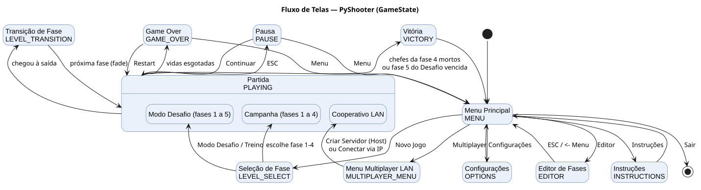
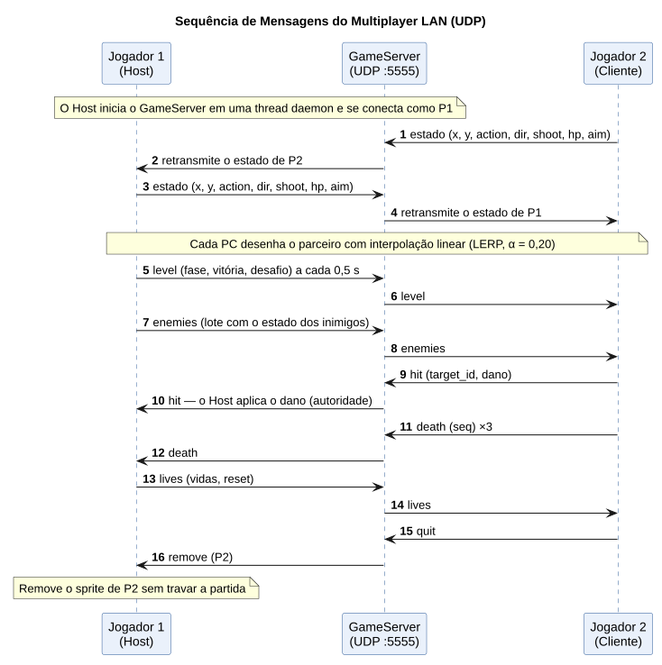
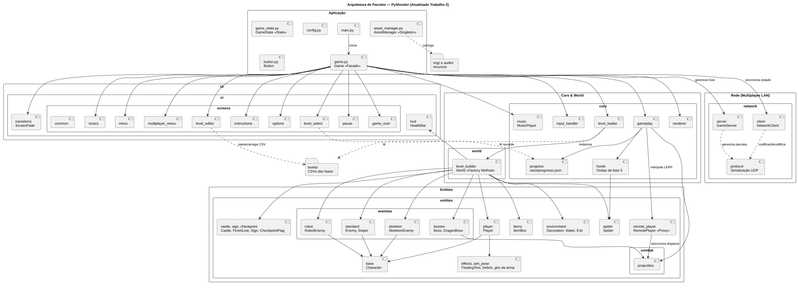
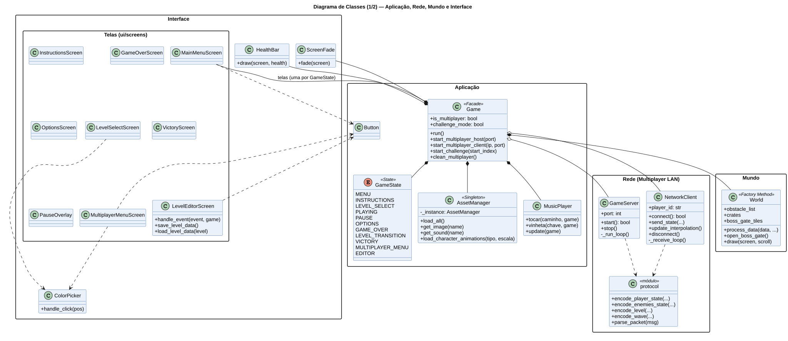
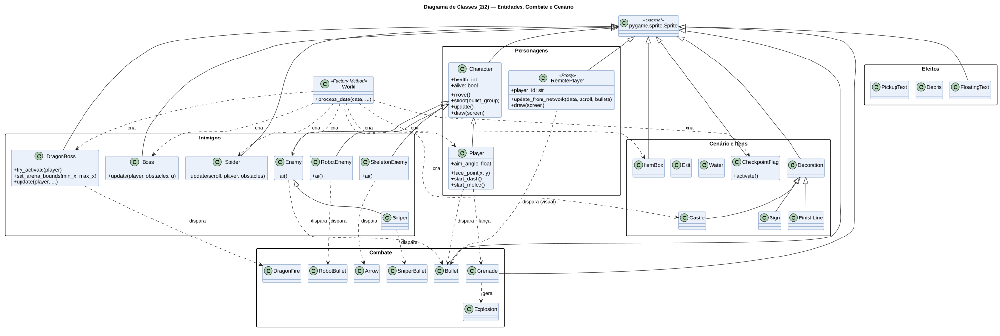

# GDD TAC III - PyShooter

Trabalho 1 + Trabalho 2 · Tópicos Avançados em Computação III · UFGD/FAEN · Prof. Vanderson Hafemann Fragal

Desenvolvedores:
**Guilherme Silva Sampaio:** Correções de arquitetura, multiplayer LAN (UDP/threads), editor de fases integrado, padrões de projeto, criação e revisão do GDD, geração UML, refatoração e testes.
**Pedro Henrique Gonçalves Mota:** Criação do projeto base, obtenção dos assets para o jogo, mecânicas de gameplay, chefes e fases, criação e revisão do GDD.

## 1. Game Design Document (GDD)

### 1.1 Conceito Principal

PyShooter é um jogo de ação 2D side-scrolling onde o jogador assume o papel de um soldado em uma missão de combate através de terrenos naturais hostis: florestas de pinheiros, pântanos e montanhas nevadas. O jogador avança horizontalmente por fases, enfrentando soldados, snipers, robôs, esqueletos, aranhas e dois chefes (Demônio e Dragão), coletando suprimentos (munição, granadas, kits médicos e vidas extras) e superando obstáculos como plataformas elevadas, corpos d'água e caixas de madeira. O objetivo é sobreviver e chegar à saída de cada fase até derrotar os chefes da fase 4.

No Trabalho 2 o jogo ganhou: navegação completa por menus, editor de fases integrado, multiplayer cooperativo em LAN (UDP + threads), padrões de projeto formalizados, mira com o mouse, dash, golpe, sistema de vidas, checkpoints, pontuação com combo, Modo Desafio com arena de hordas, tela cheia e trilha sonora por fase.

### 1.2 Estilo / Gênero

| Aspecto | Classificação |
| --- | --- |
| **Gênero primário** | Run and Gun / Platformer Shooter 2D |
| **Subgênero** | Side-scrolling Action / Cooperativo em LAN |
| **Perspectiva** | Vista lateral (side-view) |
| **Referências clássicas** | Metal Slug, Contra, Ghosts 'n Goblins |

O jogo se encaixa no gênero Run and Gun 2D: o jogador se move horizontalmente, pula entre plataformas e dispara contra inimigos enquanto avança. Não há elementos de puzzle significativos, reforçando o foco na ação direta.

### 1.3 Plataforma Alvo

| Requisito | Especificação |
| --- | --- |
| **Sistema Operacional** | Windows (compatível com qualquer SO que suporte Python + Pygame) |
| **Python** | 3.10+ |
| **Dependências** | pygame-ce, Pillow |
| **Resolução de tela** | 1200 × 640 pixels (editor: 1200 × 740); tela cheia opcional (F11) |
| **Periféricos** | Teclado e Mouse (mira, tiro, golpe, menus e editor) |
| **Rede** | LAN (Ethernet, Wi-Fi ou VPN), UDP porta 5555 |
| **Hardware mínimo** | Qualquer PC capaz de rodar Python; sem exigências de GPU dedicada |

### 1.4 Mecânicas e Física

#### 1.4.1 Mapa Completo de Controles

**Controles de Jogo (In-Game)**

| Tecla | Ação |
| --- | --- |
| A ou ← | Mover para a esquerda |
| D ou → | Mover para a direita |
| W ou ↑ | Pular |
| Mouse | Mirar (a arma gira acompanhando o cursor) |
| Botão esquerdo | Atirar na direção da mira (segurar para tiro contínuo) |
| Botão direito | Golpe com a arma (curto alcance; quebra caixas) |
| Espaço | Dash (impulso rápido com invencibilidade) |
| Q ou G | Lançar granada |
| E | Ler placa próxima |
| F11 | Ligar/desligar tela cheia |
| ESC | Pausar |

**Controles de Menu**

| Periférico | Ação |
| --- | --- |
| Mouse (clique esquerdo) | Botões dos menus, seleção de fase, seletor de cor, campo de IP e sliders de volume |
| Ctrl+V | Colar o IP do Host no Menu Multiplayer |

**Controles do Level Editor**

| Tecla | Ação |
| --- | --- |
| ← / → | Scroll do mapa no editor |
| ↑ / ↓ | Mudar número do nível |
| Shift | Aumentar velocidade do scroll (5x) |
| Mouse esquerdo | Pintar tile selecionado |
| Mouse direito | Apagar tile |
| M | Modo Mover (arrasta um objeto; troca de lugar se a célula estiver ocupada) |
| Ctrl+Z / Ctrl+Y | Desfazer / Refazer (até 100 passos) |
| Botões Salvar / Carregar | Grava ou lê `levels/levelN_data.csv` |
| ESC | Voltar ao menu |

#### 1.4.2 Habilidades do Personagem Principal

| Habilidade | Descrição | Parâmetros |
| --- | --- | --- |
| **Movimento** | Caminhar em ambas as direções | Velocidade: 5 px/frame |
| **Pulo** | Pulo simples (sem pulo duplo) | Impulso: -14; gravidade: 0.75 |
| **Tiro** | Projétil na direção da mira do mouse | Cooldown: 20 frames; dano: 25 HP (inimigos), 5 HP (jogador); munição inicial: 20 |
| **Granada** | Arremesso em arco parabólico | Dano: 50 HP em área; raio: 2 tiles; timer: 100 frames; estoque inicial: 5 |
| **Dash** | Impulso horizontal sem gravidade e invencível | 16 px/frame por 10 frames; recarga: 50 frames |
| **Golpe** | Ataque corpo a corpo com a arma | Alcance: 60 px; dano: 35; recarga: 24 frames |
| **Coleta de itens** | Pegar caixas de suprimentos | Vida: +25 HP, Munição: +15, Granadas: +3, Coração: +1 vida |
| **Vidas** | Equipe com vidas compartilhadas | 3 vidas (máx. 5); renasce em 1 s no início ou na última bandeira |

#### 1.4.3 Inimigos e Chefes

| Inimigo | Comportamento | Pontos |
| --- | --- | --- |
| **Soldado** | Patrulha e atira em linha reta ao ver o jogador | 100 |
| **Sniper** | Tiro de longo alcance | 200 |
| **Robô** | Disparo de energia vetorial | 150 |
| **Esqueleto** | Flechas teleguiadas (trigonometria) | 150 |
| **Aranha** | Desenhada pelo código; persegue e fere por contato (10 de dano) | 50 |
| **Demônio (chefe)** | Terrestre de curto alcance; Arena 1 da fase 4 | 1500 |
| **Dragão (chefe)** | Voador; dorme na Arena 2 e acorda com o jogador perto; leque de 5 tiros e rajada de 3; com metade da vida entra em Fúria (mais rápido, mergulho rasante) | 2000 |

#### 1.4.4 Modos de Jogo e Progressão

| Elemento | Regra |
| --- | --- |
| **Campanha** | Fases 1 a 4. As fases 1 a 3 terminam em um castelo; a fase 4 termina ao matar os dois chefes (tela de Vitória). Fases vencidas ficam salvas em `save/progresso.json`. |
| **Arena dos Chefes (fase 4)** | Um portão (tile 90) divide a fase: o Demônio na Arena 1; ao morrer, o portão explode ("PASSAGEM LIBERADA!") e o Dragão desperta na Arena 2. |
| **Checkpoints** | Bandeira (tile 88) salva posição, munição e granadas; ao perder vida o jogador renasce nela. |
| **Modo Desafio** | Liberado após zerar a campanha: fases 1 a 5 seguidas, uma vida, sem checkpoints, cronômetro e recorde de tempo. Treino a partir de qualquer fase (sem recorde). |
| **Arena de Hordas (fase 5)** | 5 ondas pelos dois lados, 3 s de pausa e suprimentos entre elas, os dois chefes na última. Após 8 s sem matar, uma seta aponta o inimigo mais próximo. |
| **Cooperativo LAN** | 2 jogadores, vidas compartilhadas, colisão entre os soldados (um sobe na cabeça do outro), cores diferentes. |
| **Pontuação** | Pontos por inimigo × combo (até x5); o combo continua se a próxima morte for em até 2,5 s. |
| **Drops** | Inimigos soltam munição (25%), vida (10%) e granada (8%); caixas de madeira soltam munição, granada, vida, coração ou aranha. Sorteio determinístico (igual nos dois PCs). |

### 1.5 Assets (Arte e Som)

#### 1.5.1 Sprites Mapeados

**Personagens (Spritesheet por frames individuais)**

| Entidade | Animações | Frames por animação | Escala |
| --- | --- | --- | --- |
| **Player** (img/player/) | Idle, Run, Jump, Death | 5, 6, 1, 8 | 1.55x (5 cores) |
| **Enemy** (img/enemy/) | Idle, Run, Jump, Death | Mesma estrutura | 1.65x |
| **SkeletonEnemy** (img/skeleton/) | Idle, Run, Shoot, Death | 7, 8, 14, 5 | 1.65x |
| **RobotEnemy** (img/robot/) | Idle, Walk, Attack, Death, Hurt | 4, 4, 4, 4, 2 | 1.55x |
| **SniperEnemy** (img/sniper/) | Idle, Walk, Shot_1, Dead, Hurt | 7, 8, 4, 5, 4 | 1.2x |
| **DemonBoss** (img/enemy/Demon/) | Idle, Walk, Attack, Death | 3, 6, 4, 6 | 1.5x |
| **DragonBoss** (img/enemy/Dragon/) | Idle, Walk, Attack, Hurt, Death | 3, 5, 4, 2, 5 | 1.5x |
| **Spider** | Desenhada pelo código (sem sprite) | — | — |

**Cenário e Tiles**

| ID do Tile | Tipo | Função no jogo |
| --- | --- | --- |
| 0–8, 24–35, 47–48, 50, 58–61, 65–66, 73–77, 83–84 | Obstáculos sólidos | Plataformas e paredes (terra, neve, pedra e grama) |
| 9–10, 37–39, 42–46, 51–57, 62–64, 67–68 | Água | Mata o jogador/inimigo ao contato |
| 11, 13–14, 36, 40, 49, 71–72, 78–82 | Decoração | Elementos visuais sem colisão |
| 12 | Caixa de madeira | Sólida até levar um golpe; solta um item sorteado |
| 15 / 16 | Spawn do jogador / soldado | Posição inicial |
| 17 / 18 / 19 | Caixas de munição / granada / vida | +15 munição / +3 granadas / +25 HP |
| 20, 41 | Saída (castelo) | Fim da fase, com linha de chegada |
| 22 | Speed Boost | Aumenta a velocidade |
| 23 | Placa | Mostra uma dica (tecla E) |
| 69 / 70 | Spawn de Robô / Esqueleto | Posição inicial |
| 85 | Rampa | Colisão diagonal |
| 86 / 87 | Spawn do Demônio / Dragão | Posição inicial dos chefes |
| 88 | Bandeira de checkpoint | Ponto de renascimento |
| 89 | Spawn de Aranha | Posição inicial |
| 90 | Portão da arena | Sólido até o Demônio morrer |

**Background (Parallax)**

| Arquivo | Descrição |
| --- | --- |
| sky_cloud.png / back.png | Céu (camada mais distante) |
| mountain.png | Silhueta de montanhas |
| pine1.png / pine2.png | Pinheiros distantes e próximos |
| background4.png | Floresta e pântano (fase 4 / arena dos chefes) |

**Ícones, Projéteis e UI**

| Arquivo | Uso |
| --- | --- |
| bullet.png / grenade.png | Projéteis e indicadores do HUD |
| health_box.png / ammo_box.png / grenade_box.png / speed_box.png | Caixas de itens |
| heartDisplay.png | Coração (+1 vida) e marcador de vidas |
| Ball1.png / Ball2.png | Projétil de energia do Robô |
| Fire_Attack1–6.png | Projétil de fogo do Dragão |
| exp1.png – exp5.png | Animação de explosão |
| gamepad1–4.png | Botões da Seleção de Fase |
| slider_base.png / slider_knob.png | Sliders de volume |
| *_button_new.png, pause_button.png | Botões dos menus e de pausa |
| save_btn.png / load_btn.png | Botões do Level Editor |

#### 1.5.2 Efeitos Sonoros e Música

| Arquivo | Tipo | Volume | Uso |
| --- | --- | --- | --- |
| shot.wav | SFX | 0.05 | Disparo |
| jump.wav | SFX | 0.05 | Pulo |
| grenade.wav | SFX | 0.05 | Explosão de granada |
| robot_shoot.wav | SFX | 0.05 | Disparo do Robô |
| skeleton_bow.wav | SFX | 0.05 | Flecha do Esqueleto |
| audio/musicas/*.ogg (14 faixas) | Música | slider | Uma por tela/fase (menu, fases 1-3, chefes e versão Climax, hordas, vitória, Game Over) e vinhetas; troca com fade |

Músicas: MintoDog (OpenGameArt), licença CC0. Créditos em `audio/CREDITOS.md`.

### 1.6 Telas e Menus

A navegação usa o padrão State: o enum `GameState` define a tela atual e cada tela de `ui/screens/` trata seus eventos e seu desenho.

| Tela | Função |
| --- | --- |
| **Menu Principal** | Novo Jogo, Multiplayer, Editor, Instruções, Configurações e Sair |
| **Seleção de Fase** | Fases 1 a 4 (concluídas em verde), seletor de cor, Modo Desafio e Treino |
| **Menu Multiplayer** | Criar Servidor (Host) ou Conectar via IP; seletor de cor |
| **Configurações** | Volume da música e dos efeitos (sliders) e tela cheia |
| **HUD** | Vida, munição, granadas, vidas, pontos, combo, mira e recarga do dash |
| **Pausa / Game Over / Vitória** | Continuar ou sair; Restart; tempo da partida e recorde |

### 1.7 Editor de Fases

| Item | Especificação |
| --- | --- |
| **Classe** | `LevelEditorScreen` (`ui/screens/level_editor.py`), integrada ao menu |
| **Mapa** | Matriz 16 linhas × 200 colunas, tiles de 40 × 40 px |
| **Paleta** | 91 tiles em 7 colunas |
| **Ferramentas** | Pintar, apagar, Modo Mover, Desfazer/Refazer (100 passos) |
| **Arquivos** | Salva e carrega `levels/levelN_data.csv` |

### 1.8 Multiplayer em LAN

Arquitetura cliente/servidor com sockets UDP e threads em segundo plano, baseada nos exemplos da disciplina. O Host roda o `GameServer` (porta 5555) e é a autoridade sobre inimigos, fase e vidas; cada PC desenha o parceiro com interpolação linear (LERP).

| Mensagem | Sentido | Conteúdo |
| --- | --- | --- |
| estado | todos | `id,x,y,action,dir,shoot,hp,aim` |
| quit / remove | cliente → servidor → todos | Saída voluntária / expulsão por timeout de 5 s |
| hit | quem acertou → Host | `target_id, dano` (o Host aplica o dano) |
| enemies / eshoot | Host → cliente | Lote com o estado dos inimigos / tiro de inimigo |
| level / levelreq | Host → cliente / cliente → Host | Fase atual, vitória e desafio / pedido de troca de fase |
| item / crate | todos | Item coletado / caixa quebrada |
| color | todos | Cor escolhida pelo jogador |
| death / lives / lifeup | cliente → Host / Host → cliente | Morte, saldo de vidas e vida extra |
| wave | Host → cliente | Início de cada onda da fase 5 |

### 1.9 Padrões de Projeto

| Padrão | Onde | Para quê |
| --- | --- | --- |
| **Singleton** | `AssetManager` | Carregar imagens e sons uma única vez |
| **State** | `GameState` + telas de `ui/screens/` | Separar menus, partida, editor e pausa |
| **Factory Method** | `World.process_data()` | Criar entidades a partir dos IDs da matriz CSV |
| **Facade** | `Game` + `core/` | Orquestrar entrada, gameplay, renderização e carregamento de fases |
| **Observer** | Laço de eventos e `NetworkClient._receive_loop` | Tratar eventos e pacotes sem travar os 60 FPS |
| **Remote Proxy** | `RemotePlayer` | Representar o jogador remoto como um sprite local |

### 1.10 Fórmulas e Mecânicas Matemáticas

#### 1.10.1 Física de Movimentação e Gravidade

Aplicada ao Jogador, Inimigos, Caixas e Granadas: a cada frame a gravidade é somada à velocidade vertical, limitada à velocidade terminal.

- **Fórmula da Gravidade (por frame):**

\[ V_y = \min(V_y + 0{,}75,\; 10) \]

- **Fórmula do Pulo:**

\[ V_y = -14 \]

#### 1.10.2 Visão da Inteligência Artificial (Cálculo de Distância)

Os inimigos decidem atirar ou seguir medindo a distância entre os centros do jogador e do inimigo (`math.hypot`).

\[ d = \sqrt{(X_{\text{jogador}} - X_{\text{inimigo}})^2 + (Y_{\text{jogador}} - Y_{\text{inimigo}})^2} \]

#### 1.10.3 Mira e Tiros Teleguiados (Trigonometria)

Usada nas flechas dos Esqueletos, no fogo do Dragão e no tiro do jogador (mira no mouse).

- **Cálculo do Ângulo de Tiro:**

\[ \theta = \operatorname{atan2}(Y_{\text{alvo}} - Y_{\text{origem}},\; X_{\text{alvo}} - X_{\text{origem}}) \]

- **Decomposição da Velocidade nos Eixos:**

\[ dx = \cos(\theta) \times \text{Velocidade} \qquad dy = \sin(\theta) \times \text{Velocidade} \]

#### 1.10.4 Giro da Arma do Jogador

Só a arma gira (o corpo fica parado), limitada a ±89°. A ponta do cano, de onde sai a bala, é obtida pela rotação 2D em torno da empunhadura:

\[ P_{\text{cano}} = P_{\text{pivô}} + \begin{pmatrix} \cos\theta & -\sin\theta \\ \sin\theta & \cos\theta \end{pmatrix} (P^0_{\text{cano}} - P^0_{\text{pivô}}) \]

#### 1.10.5 Proporção da Interface de Usuário (Barra de Vida)

- **Razão de Vida:**

\[ \text{Razão} = \frac{\text{Vida Atual}}{\text{Vida Máxima}} \]

- **Fórmula de Renderização:**

\[ \text{Largura Exibida} = \text{Razão} \times \text{Largura Total da Barra} \]

#### 1.10.6 Física Parabólica e Reflexão (Granada)

- **Movimento do Arco Parabólico:** deslocamento fixo em X e acelerado em Y.

\[ dx = \text{Direção} \times 7 \qquad dy = V_y \;\; (V_y \mathrel{+}= 0{,}75) \]

- **Reflexão Horizontal (Quique em Paredes):**

\[ \text{Direção} = \text{Direção} \times (-1) \]

#### 1.10.7 Interpolação Linear (LERP) do Multiplayer

A posição exibida do parceiro anda 20% em direção à posição recebida a cada frame, evitando "teleportes":

\[ P_{\text{atual}} = P_{\text{atual}} + (P_{\text{alvo}} - P_{\text{atual}}) \times 0{,}20 \]

#### 1.10.8 Dash

\[ \Delta x = 10\ \text{frames} \times 16\ \text{px} = 160\ \text{px} \;(\approx 4\ \text{tiles}) \]

#### 1.10.9 Pontuação com Combo

\[ \text{Pontos} = \text{Pontos}_{\text{base}} \times \min(5,\; c) \]

O multiplicador c sobe 1 a cada morte feita em até 150 frames (2,5 s) da anterior e volta a 1 quando o tempo acaba.

## 2. Engenharia de Requisitos

### 2.1 Requisitos Funcionais (RF)

| ID | Requisito |
| --- | --- |
| **RF-01** | O sistema deve permitir que o jogador se mova horizontalmente utilizando as teclas A/D ou setas direcionais. |
| **RF-02** | O sistema deve permitir que o jogador pule ao pressionar W ou seta para cima, aplicando gravidade simulada. |
| **RF-03** | O sistema deve permitir que o jogador dispare projéteis na direção da mira com o botão esquerdo do mouse, com cooldown de 20 frames e consumo de munição. |
| **RF-04** | O sistema deve permitir que o jogador lance granadas (Q/G) em trajetória parabólica, que explodem após um timer e causam dano em área. |
| **RF-05** | O sistema deve detectar colisão entre projéteis e personagens, aplicando dano diferenciado (25 HP em inimigos, 5 HP no jogador). |
| **RF-06** | O sistema deve carregar fases a partir de arquivos CSV (`levelN_data.csv`), interpretando uma matriz 16×200 de IDs de tiles. |
| **RF-07** | O sistema deve implementar IA para inimigos com patrulha, detecção do jogador e ataque. |
| **RF-08** | O sistema deve permitir a coleta de itens (vida +25, munição +15, granadas +3, coração +1 vida). |
| **RF-09** | O sistema deve exibir HUD com vida, munição, granadas, vidas, pontos e combo. |
| **RF-10** | O sistema deve transicionar entre as fases ao jogador alcançar a saída, com efeito de fade. |
| **RF-11** | O sistema deve oferecer menus de Novo Jogo, Multiplayer, Editor, Instruções, Configurações e Sair. |
| **RF-12** | O sistema deve permitir ajustar o volume da música e dos efeitos por sliders. |
| **RF-13** | O sistema deve oferecer um editor de fases para pintar, apagar, mover, desfazer/refazer e salvar/carregar CSV. |
| **RF-14** | O sistema deve permitir criar um servidor LAN UDP na porta 5555 (modo Host). |
| **RF-15** | O sistema deve permitir conectar a uma partida pelo IP do Host (modo Cliente). |
| **RF-16** | O sistema deve sincronizar posição, ação, direção, mira e tiros entre os jogadores, suavizando com LERP. |
| **RF-17** | O sistema deve encerrar a campanha com tela de Vitória ao derrotar os dois chefes da fase 4. |
| **RF-18** | O sistema deve salvar fases concluídas, campanha zerada, cor, tela cheia e recorde em `save/progresso.json`. |
| **RF-19** | O sistema deve registrar checkpoints (tile 88) e renascer o jogador na última bandeira ativada. |
| **RF-20** | O sistema deve oferecer o Modo Desafio (fases 1 a 5, uma vida, cronômetro e recorde). |
| **RF-21** | O sistema deve manter Host e Cliente na mesma fase e levá-los juntos à Vitória. |
| **RF-22** | O sistema deve girar a arma do jogador acompanhando o cursor do mouse. |
| **RF-23** | O sistema deve permitir o dash (Espaço) com invencibilidade e recarga de 50 frames. |
| **RF-24** | O sistema deve controlar 3 vidas compartilhadas (até 5), com renascimento em 1 s sem recarregar a fase. |
| **RF-25** | O sistema deve permitir o Modo Desafio em dupla, com espectador para quem cair e fim quando os dois caírem. |
| **RF-26** | O sistema deve dividir a fase 4 em duas arenas por um portão, que abre quando o Demônio morre; o Dragão acorda com a aproximação e entra em Fúria com metade da vida. |
| **RF-27** | O sistema deve pontuar cada inimigo com multiplicador de combo (até x5) e soltar suprimentos de forma determinística. |
| **RF-28** | O sistema deve permitir escolher a cor do soldado, sem cores repetidas na dupla. |
| **RF-29** | O sistema deve permitir ler placas (E) e ter colisão entre os dois jogadores. |
| **RF-30** | O sistema deve terminar as fases 1 a 3 em um castelo com linha de chegada. |
| **RF-31** | O sistema deve permitir o golpe com a arma (botão direito), que fere inimigos e quebra caixas. |
| **RF-32** | O sistema deve ter caixas de madeira quebráveis com conteúdo sorteado igual nos dois PCs. |
| **RF-33** | O sistema deve ter o inimigo Aranha (tile 89, caixas e hordas). |
| **RF-34** | O sistema deve ter a arena de hordas na fase 5 do Desafio (5 ondas, chefes na última). |
| **RF-35** | O sistema deve mostrar uma seta para o inimigo mais próximo após 8 s sem matar na arena de hordas. |
| **RF-36** | O sistema deve permitir treinar o Desafio a partir de qualquer fase, sem gravar recorde. |
| **RF-37** | O sistema deve oferecer tela cheia (F11) e música por tela/fase com fade. |

### 2.2 Requisitos Não Funcionais (RNF)

| ID | Requisito |
| --- | --- |
| **RNF-01** | Desempenho: O jogo deve manter taxa de quadros estável de 60 FPS. |
| **RNF-02** | Portabilidade: O jogo deve rodar em qualquer sistema operacional com Python 3.10+ e Pygame. |
| **RNF-03** | Usabilidade: O carregamento de uma fase deve ser imperceptível (< 1 segundo), com assets carregados na inicialização. |
| **RNF-04** | Manutenibilidade: Os níveis devem ser editáveis pelo editor sem alterar código-fonte; responsabilidades separadas por módulo. |
| **RNF-05** | Consumo de Memória: Assets carregados uma única vez (Singleton) e sprites limpos via kill() e Group.empty(). |
| **RNF-06** | Rede: Pacotes UDP pequenos (< 128 bytes) para baixa latência em LAN. |
| **RNF-07** | Tolerância a falhas: Desconexão por timeout após 5 s sem travar o jogo. |

## 3. Arquitetura do Sistema e UML

### 3.1 Diagrama de Módulos (Pacotes)

**Descrição da Estrutura:**
O projeto adota uma arquitetura modularizada, separando ciclo de vida, rede, lógica de mundo, entidades e interface gráfica:

- **Aplicação:** ponto de entrada (`main.py`), fachada `Game` (`game.py`), máquina de estados `GameState`, configurações (`config.py`), `AssetManager` e `Button`.
- **Rede:** `network/` com `GameServer`, `NetworkClient` e o módulo `protocol` (codificação dos pacotes).
- **Core & World:**
    - `core/`: entrada (`input_handler`), regras (`gameplay`), carregamento de níveis (`level_loader`), renderização (`renderer`), hordas (`horde`), progresso salvo (`progress`) e música (`music`).
    - `world/`: `World` (`level_builder`), que processa as matrizes CSV.
- **Entities:** `base` (Character), `player`, `remote_player`, `enemies` (standard, robot, skeleton, bosses), `spider`, `combat` (projectiles), `items`, `environment`, `castle`, `sign`, `checkpoint`, `effects` e `aim_pose`.
- **UI:** `hud`, `transitions` e `screens` (menu, level_select, multiplayer_menu, level_editor, instructions, options, pause, game_over, victory, common).
- **Recursos externos:** `levels/` (CSV), `img/`, `audio/` e `save/`.

### 3.2 Diagrama de Dependências (Classes UML)

**Análise da Orientação a Objetos:**
A classe `Game` gerencia o `GameState`, o `AssetManager`, o `World`, o `Player`, as telas, a música e, no multiplayer, o `GameServer` e o `NetworkClient`. Todas as entidades derivam de `pygame.sprite.Sprite`; `Character` é a base de `Player` e dos inimigos comuns.

**Relacionamentos-Chave:**

| Relacionamento | Tipo | Descrição |
| --- | --- | --- |
| **Game → GameState** | Composição | Estado atual da aplicação (telas e partida). |
| **Game → AssetManager** | Composição | Carregamento centralizado de imagens e sons. |
| **Game → World** | Composição | Nível atual do jogo. |
| **Game → Telas** | Agregação | Uma tela de `ui/screens/` para cada estado. |
| **Game → GameServer / NetworkClient** | Agregação | Existem só no multiplayer. |
| **NetworkClient / GameServer → protocol** | Uso | Codificam e decodificam os pacotes. |
| **Character → pygame.sprite.Sprite** | Herança | Base das entidades vivas. |
| **Player / Enemy / RobotEnemy / SkeletonEnemy → Character** | Herança | Jogador e inimigos comuns (Sniper herda de Enemy). |
| **RemotePlayer → Sprite** | Herança (Proxy) | Representa o jogador remoto. |
| **Castle / FinishLine / Sign → Decoration** | Herança | Elementos de cenário especializados. |
| **World → Entidades do jogo** | Criação (Factory) | `process_data()` lê o CSV e instancia jogador, inimigos, chefes, aranhas, itens, bandeiras e cenário. |
| **Player / Inimigos → Projéteis** | Associação Dinâmica | Bullet, SniperBullet, RobotBullet, Arrow, DragonFire e Grenade. |
| **Grenade → Explosion** | Composição Dinâmica | A granada gera a explosão ao fim do timer. |
| **Telas → Button / ColorPicker** | Uso | Botões e seletor de cor. |

### Link do github com o código-fonte

<https://github.com/pedromota05/TrabalhoTACIII-PyShooter.git>
